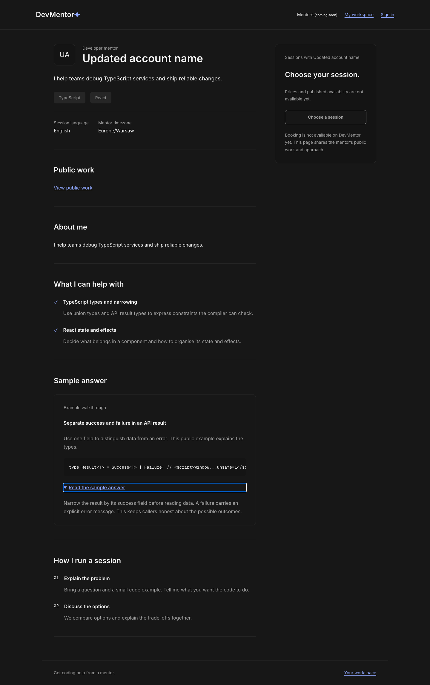
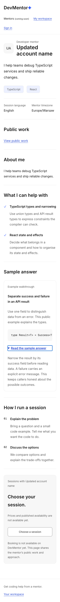
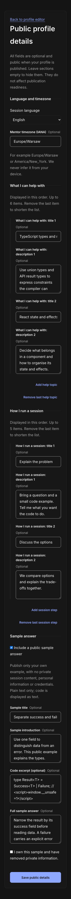
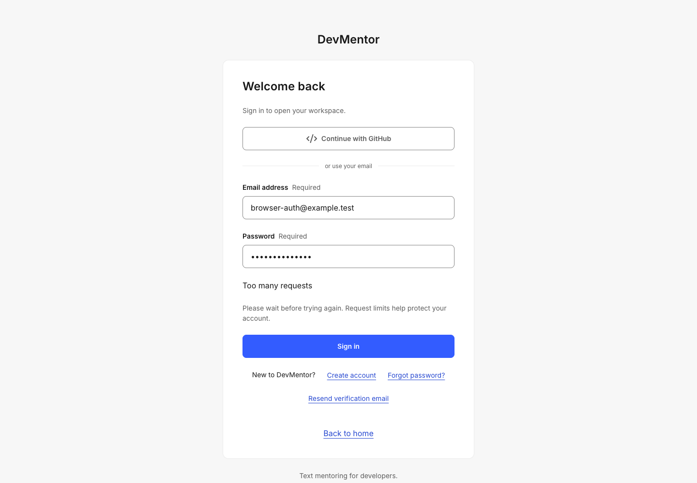

# PR 29 — browser QA evidence

Date: 2026-11-02. Mode: automated production-browser evidence via repository-native disposable PostgreSQL/HTTPS/agent-browser integration runner. No developer database or real user data used. This report does not grant independent manual QA sign-off.

| Priority / action | Expected / observed | Result |
|---|---|---|
| P0 owner/public access | Current verified mentor ownership, CSRF, 32KiB bound, draft/unpublish/role-removal denial; five-key API unchanged and detail DTO strips identity/confirmation | PASS — DB/HTTP tests |
| P1 sample validation | Blank title marks/focuses sample title; ownership confirmation required; corrected values save and survive reload | PASS — new regression fails on original source, passes after fix; native production browser assertion |
| P1 timezone | Numeric offset +02:00 rejected422; named zone/UTC remain valid | PASS — unit and production HTTP |
| P1 public reading | Literal script text remains inert; sample opens with native Enter; lower process/footer render | PASS — production browser |
| P1 narrow/theme layout | 1440px/390px/320px light/dark, no page overflow, locally scrolling code and single-line step markers | PASS — full-page screenshots inspected |
| P1 empty/long states | Optional sections absent when empty; long code stays in a local scroll region | PASS — eight light/dark Storybook interaction/accessibility tests |
| P0 shared auth quota | Wrong password denied; scoped fixed-window fixture yields real429 without counting earlier-window attempts | PASS — full production-browser suite |

Additional checks: full auth/admin/outage/installer integration passes; lint/typecheck,186 unit tests at100% all four coverage measures, build and Storybook typecheck pass. Two earlier full local attempts hit HTTP timeouts; final isolated full run exited0 without changing timeouts or weakening production behavior.

Limits: no formal perceived-performance benchmark or independent manual risk-high sign-off. Optional-details loading/error paths are covered by unit/shared resource tests; unrelated auth/admin loading/error/retry flows are exercised by the native runner. Actual offer/booking and reviews remain explicit external dependencies. Mandatory audit is still FAIL:25 moderate,0 high/critical; no forced major dependency overrides.

## Fresh captures

