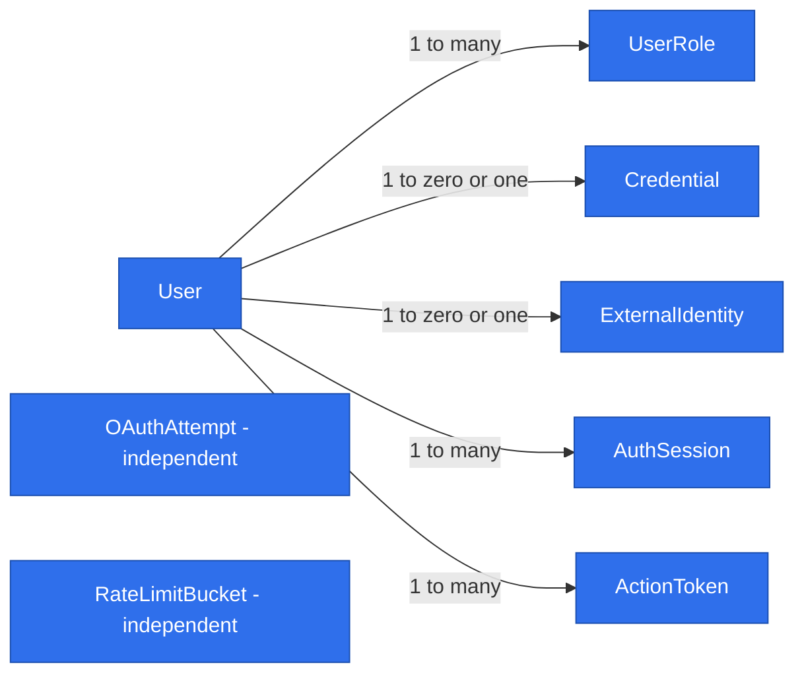

# Users, authentication and reusable application primitives

## 📝 TLDR

Proposed: deliver issue [#4](https://github.com/AndreiRymskikh/dev_mentor/issues/4) using reusable server, persistence and UI primitives that can support the agreed catalog, availability, booking and feedback flows. The application already has HTTP envelopes, CRUD wiring, fail-closed security helpers, request-scoped Awilix composition and basic UI helpers; it has no production authentication or ORM runtime. Extend and validate those foundations through real users/authentication flows rather than introduce a parallel framework.

Status: proposed design for review; no implementation performed. Source: [issue #4](https://github.com/AndreiRymskikh/dev_mentor/issues/4).

## Confirmed decisions

- One user can hold developer, mentor and administrator roles simultaneously. Registration grants developer; users can add mentor themselves. Only administrators grant administrator, except the first-admin operator bootstrap.
- Email verification and password recovery are included. Account linking/unlinking is deferred: credentials and GitHub collisions are rejected without merging identities or attaching new credentials.
- One feature specification; reusable foundations are delivered through working feature slices. Concrete abstractions cover the agreed MVP, not deferred vault/subscriptions/MCP.
- The operator-only first-admin command is approved. It is the sole exception to administrator-only administrator grants.

## 📝 Problem Statement and evidence

The owner requests a specification for working Users/Roles/Login and reusable backend/frontend foundations. Issue #4 confirms developer, mentor and administrator roles, multiple roles per user, public email/password or GitHub registration and administrator-only administrator grants. The GitHub backlog currently contains only issue #4 open and the closed setup issue #1; other product features are roadmap evidence from [the product brief](product-brief.md), not filed implementation tickets.

D02–D04 cover catalog, mentor profiles/calendar, booking with mentor approval and own-booking changes, external support contacts and post-service feedback. Vault, subscriptions and MCP are deferred; payment and sessions remain off-site; N01/N02 exclude video and public profile ratings. Business-demand hypotheses and unresolved booking details do not become framework requirements.

## 📝 Proposed scope for detailed design

Produce a traceability matrix from each confirmed feature family to existing helpers, missing primitives, consumers and verification. Evaluate request context/lifetime, service contracts and explicit DI, lazy MikroORM/unit-of-work and migrations, validation/errors/DTOs, identity/authorization/ownership, bounded list queries and pagination, and external-provider ports/adapters. On the frontend evaluate API consumption, forms/field errors, tables/list state, access-aware navigation, admin layout, and loading/empty/error feedback. Each candidate needs a concrete consumer and a reason existing helpers are insufficient.

Preserve app → core → db and standalone UI; keep Next/React out of core, persistence out of browser code, and domain rules out of generic CRUD. No speculative module discovery, queues, universal repository/service base classes or policy engine. Domain-specific availability and booking rules remain in their future feature designs.

Existing entry points: `packages/core/src/http/{apiHandler,makeCrudRoute,auth,errors}.ts`, `packages/core/src/container/`, `packages/db/src/index.ts`, and `packages/ui/src/backend/{api,forms,tables,feedback}/`. [Engineering standards](2026-09-01-engineering-standards.md) and [compatibility](../../BACKWARD_COMPATIBILITY.md) govern consumer migration, ownership, security and validation. Issue #4 supersedes the older no-RBAC statement only for the confirmed role requirements.

## 📝 Architecture and lifecycle

Reuse `apiHandler`, `makeCrudRoute`, typed `AppError`, `apiCall` and `withScope`. Do not create generic service/repository inheritance or an endpoint-generation DSL. Auth commands are explicit service methods, not unrestricted CRUD over security entities.

`app` owns Next handlers, cookies, redirects and composition adapters. `core` owns users/authentication rules, Zod validators, explicit service contracts, authorization, and GitHub/email ports. `db` owns MikroORM runtime, entities, repositories and migration operations and imports no workspace package. `ui` receives serializable DTOs/callbacks and imports no core/db. App client components import pure validator exports, never server container/logger exports.

A lazy process-level ORM/pool is initialized only when a database-backed request needs it. Each database request gets a fresh forked EntityManager, repositories and scoped services through the typed Awilix cradle. `finally` disposes the scope; never close the shared pool per request. Concurrent initialization shares a promise; failed initialization clears it to permit retry. Shutdown closes the shared ORM. Transactions bind all participating repositories to their transaction EntityManager; do not accidentally use an outer fork. Keep `/api/health`, build and static home independent of DB/auth/email secrets.

Resolve the authenticated principal once per request from a verified session and current user/role rows; never accept user IDs or roles from headers/body as authentication. No cross-request principal cache. Server pages call the same application services as HTTP routes through app composition, not their own HTTP endpoint. Authorization belongs in service operations too, so non-HTTP invocation cannot bypass it.

### Feature-to-primitive traceability

| Feature evidence | Reuse/extend in this delivery | Future boundary; no feature implementation |
| --- | --- | --- |
| Users/admin (#4) | Scoped ORM, explicit users repository, validated bounded list query/DTO, existing table and feedback composition | Catalog lists use their own public DTO/query policy |
| Login/roles (#4) | Principal resolver, membership/ownership checks, explicit auth commands | Mentor availability and developer bookings check owner plus role |
| Verification/reset (#4, owner confirmed) | Expiring single-use token storage, email port/SMTP adapter | No general notification bus or workflow engine |
| GitHub (#4) | Provider-specific adapter behind core identity port | No plugin registry or unused provider adapters |
| Forms (#4) | Shared field/errors/pending primitives extracted from CrudForm, composed auth forms | Availability and feedback have feature-specific forms |
| D02–D04 booking/availability | Transaction callback contract proven by reset and role-change races | Slot locking, calendar widgets and booking state machine await their specs |
| D04 support/feedback | Reuse existing empty/error/loading feedback | No helpdesk engine, public ratings or generic form-builder |

Keep generic `CrudForm` compatible. Extract presentation/validation state only where auth forms demonstrate a gap: their button labels, recovery links and verification states cannot be forced into Save/Cancel CRUD UX. Add composable submit labels/field feedback rather than a schema-driven screen framework. Use shadcn CLI primitives for admin only as needed.

## 📝 Data Model

All entities below are new; no implemented entities currently exist. Use UUID identifiers, UTC timestamps, PostgreSQL constraints, explicit migrations and narrowly scoped repository methods. Never return entities or secret columns to clients.

| Entity | Fields/constraints and purpose |
| --- | --- |
| User | id, normalizedEmail unique, displayName bounded, emailVerifiedAt nullable, createdAt, updatedAt; normalize by trimming/lowercasing, no provider-specific dot/plus rewriting |
| UserRole | userId FK, role enum developer/mentor/administrator; composite primary key; no editable Role/Permission tables |
| Credential | userId unique FK, bcrypt hash cost >=12, passwordChangedAt; optional per user; no plaintext password storage |
| ExternalIdentity | userId unique FK for this delivery, provider fixed github, providerSubject; unique provider/subject; no retained GitHub access token |
| AuthSession | id, userId FK, expiresAt, revokedAt nullable; stores no role snapshot |
| ActionToken | id, userId FK, purpose verify-email/reset-password, digest unique, expiresAt, consumedAt nullable; SHA-256 digest of cryptographically random >=32-byte token; never store raw token |
| OAuthAttempt | id, stateDigest unique, browserBindingDigest, encrypted PKCE verifier, expiresAt, consumedAt nullable; no User FK before authentication |
| RateLimitBucket | keyDigest + windowStart composite key, attemptCount, expiresAt; shared across instances; no raw email/IP in key |

User has zero-or-one Credential, zero-or-one ExternalIdentity, many memberships/sessions/tokens. Service invariants forbid Credential and ExternalIdentity coexisting until a future linking design. Foreign keys prevent orphans. No user deletion endpoint in scope; future deletion requires explicit retention/cleanup policy. Expired operational records are removed by a bounded operator maintenance command, not a new queue framework.

## 📝 Identity and security contracts

**Sessions:** signed JWT in HttpOnly cookie, HS256, >=32-byte secret, issuer/audience/algorithm pinned, 24-hour absolute expiry, no refresh flow. Cookie uses Secure in production, SameSite=Lax, Path=/, no Domain, and identical deletion attributes; production uses a __Host- prefixed name. Never store tokens in localStorage. JWT contains subject and AuthSession ID, not authoritative roles. Credentials session creation locks the User row and rechecks the current password hash before issuing a session, serialized against password reset. Every protected request checks session expiry/revocation and reads current memberships. Logout revokes the session and expires its cookie; reset revokes all user sessions. A request whose authorization read begins after a role-change commit sees new roles; an already authorized in-flight read may finish. Role-sensitive mutations lock the actor User row and recheck privileges in the same transaction, with role writers taking the same lock. This prevents stale authorization from committing after revocation without introducing a global policy engine.

Replace singular `Session.role` with readonly typed `roles`; `requireRole` tests membership. Add any/all variants only for real consumers, with explicit naming. Migrate all consumers/tests/exports together; no ambiguous singular fallback. Ownership remains required; administrator powers exist only on explicit administration operations. UI visibility never grants permission.

**Roles:** verified developers may self-enroll as mentors idempotently. Admin can grant/revoke mentor or administrator on users; developer remains baseline. No self-service administrator role. Serialize administrator membership changes and bootstrap with a dedicated PostgreSQL transaction advisory lock using a constant key through parameterized ORM execution; re-read the actor inside it. Never remove the last administrator. No role deletion, arbitrary permission editing or organization tenancy.

**Credentials:** password length 12–72 UTF-8 bytes, no silent bcrypt truncation, no password logging. Registration stores bcrypt hash and unverified account; verification consumes an expiring token before credentials login can issue a session. Verification TTL 24 hours, reset TTL 30 minutes. Reset can only replace an existing Credential, never add credentials to GitHub-only accounts. Verification never overwrites an identity/email from a token payload: derive user and purpose from persisted digest.

**Token concurrency:** lock the user row for issuing or consuming tokens of a purpose; invalidate prior outstanding tokens when issuing a replacement. Conditional consumption, credential update and reset session revocation occur atomically; concurrent token replay has at most one successful effect. Email links open an app page; consumption happens only on CSRF-protected POST, never GET/link-preview. Put raw token in URL fragment, read in client, strip from history, use no third-party resources and no-referrer policy. Invalid/expired/used tokens display a safe retry path.

**Email:** core `EmailSender` port with explicit verification/reset message types; SMTP adapter configured server-side with fixed sender and app origin. Never derive links from Host headers. Persist token, then await bounded delivery; on send failure invalidate that token if still active. Public register/resend/forgot responses remain generic even on failure; log a fixed delivery failure event without address/token. User may retry after cooldown; no guarantee of delivery and no background outbox in this scope. Integration uses a disposable mail sink and tests failure/retry. Production activation requires tested SMTP credentials; secrets absent fail the relevant operation closed, not build/health.

**Rate limits:** atomic PostgreSQL buckets keyed by HMAC of normalized email/IP plus operation (separate server secret), plus per-IP buckets; login 5 attempts/15 minutes per pair and 50/IP, email sends 3/hour per address and 20/IP, registration 10/hour/IP. Successful login does not erase per-IP protection. Return 429 with bounded Retry-After without revealing account existence. Trust client IP only from an explicitly configured trusted proxy; otherwise use direct peer information or a conservative shared bucket. Storage failure denies protected auth operations with safe 503, never bypasses limits.

**GitHub:** authorization-code flow with state, browser binding and S256 PKCE; five-minute single-use OAuthAttempt, exact configured redirect URI, short provider timeouts and minimal read:user/user:email scope. Encrypt persisted verifier with authenticated encryption using a separate environment key and maintained library; browser receives only an HttpOnly binding cookie. Atomically consume the attempt before token exchange; failed exchange requires restart. Fetch stable numeric GitHub user ID and verified primary email (or first verified email); if none, stop with actionable UI. Existing provider subject logs into its original user without silently rewriting email. For a new identity, atomically create User with emailVerifiedAt set from the verified provider evidence, ExternalIdentity and baseline developer membership before issuing a session. New subject with an existing normalized email is a collision: reject without linking. Concurrent creates rely on unique constraints and map conflicts safely. Discard access token after identity fetch; never request repository permissions.

Next cookie reads are asynchronous; mutate cookies only in handlers before streaming, per installed Next 16.4 docs. Login/logout already need cookie headers, and registration needs explicit 202: introduce the response metadata capability in phase 2, then use its redirect mode in phase 4. OAuth start/callback require browser redirects, so extend the existing apiHandler with an explicitly typed response mode that preserves standard error handling while permitting redirects/cookies. JSON routes retain the existing envelope. OAuth callback GET is a documented CSRF exception secured by state/browser binding/PKCE, not the custom-header guard intended for JSON POST. Errors redirect only to fixed same-origin status pages; no raw query/provider errors or arbitrary return URLs.

## 📝 API Contracts

All JSON bodies use strict explicit Zod shapes and standard success/error envelopes; unknown role/ID fields are rejected. JSON mutations require existing CSRF guard and same-origin checks. Sensitive responses are no-store. Protected endpoints authenticate before invoking domain operations and services enforce authorization. IDs are server-generated except validated target identifiers.

| Method/path | Input; behavior |
| --- | --- |
| POST /api/auth/register | email/password/displayName; generic 202, whether duplicate or delivery failed; no session |
| POST /api/auth/login | email/password; 200 safe principal + session cookie, generic 401 for unknown/wrong/unverified |
| POST /api/auth/logout | revoke current session; idempotent 200 + expired cookie |
| GET /api/auth/session | safe principal id/displayName/roles, or 401 |
| POST /api/auth/verification/request | email; generic 202 |
| POST /api/auth/verification/confirm | token; 200 or generic token error |
| POST /api/auth/password/forgot | email; generic 202 for unknown or GitHub-only users too |
| POST /api/auth/password/reset | token/newPassword; 200 and revoked sessions, or generic token error |
| GET /api/auth/github/start | create browser-bound attempt and redirect |
| GET /api/auth/github/callback | consume code/state flow; fixed same-origin success/error redirect |
| POST /api/users/me/mentor | no role input; verified principal idempotently gains mentor |
| GET /api/admin/users | administrator; page default 1, pageSize default 20 max 100, bounded email/name query, createdAt/id stable order; safe DTO items + page/pageSize/total |
| PUT /api/admin/users/:id/roles | administrator; explicit desired mentor/admin memberships; transaction validates last-admin invariant; baseline developer retained |

Admin DTO: id/displayName/email/emailVerifiedAt/roles/createdAt; only admin may see other users' email. Public or future catalog DTO must be separately allowlisted. No generic arbitrary sorting, ORM filters, password editing by admins, account linking, profile-email mutation or user deletion endpoint.

## 📝 UI/UX

App-local `/login`, `/register`, `/verify-email`, `/forgot-password`, `/reset-password` compose shared field/pending/error components. Support password-manager autocomplete, visible labels, keyboard focus and server field errors. Do not leak existence via resend/forgot wording. Successful reset asks for login; no automatic session issuance. OAuth failure/cancel/collision offers retry or original-method login, never “link accounts.”

Verified user account page shows all roles, self-enroll-as-mentor action and logout. Administrator navigation exposes `/admin/users` list with loading/empty/error states and role-edit controls; prevent duplicate submissions but enforce permissions server-side. `/admin` now redirects authorized administrators to users; unauthenticated browser visits redirect to login, authenticated non-admin renders forbidden. API equivalents return 401/403 JSON. Preserve home assets. Email/password display-only details remain minimal, with no arbitrary profile CRUD.

## 📝 Risks, compatibility and rollback

The confirmed role scope supersedes the older no-RBAC engineering statement without adding a policy engine. Coordinate singular-session migration across all consumers and document exports. Replace the `/admin` 404 integration/browser expectation only when protected UI lands. Add response-mode tests proving cookie/redirect support preserves safe JSON error envelopes. Database routes remain force-dynamic; do not enable Cache Components.

Add migrations before enabling routes. Rollout: deploy schema, configure secrets/SMTP/GitHub, enable public registration/verification/login while admin navigation remains hidden, register and verify the operator’s credentials account through that flow, bootstrap that existing user through the operator command, then enable admin navigation and test external callbacks. Bootstrap requires an existing verified user ID, grants admin only when no admin exists, shares the admin lock, is idempotent only for the same already-admin user and otherwise refuses; never reads passwords from CLI arguments. Existing administrators use authenticated grants thereafter.

Rollback application routes first while retaining additive schema/data. Session/JWT key rotation forces reauthentication. Destructive down migration allowed only on an empty disposable database; production removal requires explicit backup/export and approved data-loss plan. Migration tests cover empty-schema up/down and rejection of destructive rollback with user data. No developer Compose volume resets. SMTP/GitHub configuration and availability are deployment prerequisites, not fabricated verification evidence. Existing 25-hour product budget is unvalidated for the expanded authentication scope; do not promise it fits.

## 📝 Research and trade-offs

Reviewed primary documentation: [MikroORM identity maps](https://mikro-orm.io/docs/identity-map) supports request-specific managers; [transactions](https://mikro-orm.io/docs/transactions) motivates transaction-bound repository use. [GitHub OAuth](https://docs.github.com/en/apps/oauth-apps/building-oauth-apps/authorizing-oauth-apps) informs state/PKCE and callback handling. [Better Auth email/password](https://better-auth.com/docs/authentication/email-password) and [identity handling](https://better-auth.com/docs/concepts/users-accounts) provide comparison patterns for verification, recovery and explicit linking boundaries.

Use maintained cryptographic/JWT/OAuth/mail libraries, not custom cryptography. A full auth framework could reduce protocol work, but is not selected here because its persistence/session ownership would need an evaluated MikroORM integration and compatibility review. Implementation must pin mutually compatible library versions and validate provider behavior; no dependency upgrade is authorized by this document. No generic auth-provider engine, Redis deployment, job broker or event bus is required.

## 📋 Phasing and Implementation Plan

Each phase is tested and leaves the app working. Future domain examples prove a reuse boundary on paper, not unused scaffolding.

1. **Persistence through registration:** include baseline developer membership and shared registration/email rate limits from the start; add lazy MikroORM initialization, isolated request/transaction lifetime, users/credentials/tokens and unique constraints; typed repositories and pure validator exports. Prove registration and delivery-failure behavior with a real disposable DB/mail sink before exposing UI.
2. **Verified credentials:** standard response metadata for statuses/cookies, verification, bcrypt login, JWT/session rows, logout, rate-limit storage and email reset; race/replay/session-revocation checks. Add auth pages using shared form-state extraction only where needed.
3. **Multiple roles and administration:** migrate singular session consumers atomically; self-enroll mentor, admin grant/revoke and serialized last-admin/bootstrap protection. Add user list/query DTO and admin UI. Update `/admin` contracts and tests.
4. **GitHub login:** minimal provider adapter, browser-bound single-use state/PKCE, exact redirects and safe collision handling. Extend the response capability with redirect mode, with backwards-compatibility tests. Never add linking endpoints.
5. **Full validation and review:** lint, typecheck, 100% per-file statements/branches/functions/lines, build, audit and repository PostgreSQL/browser integration. Exercise both login methods, verification/reset email links, stale cookies, denied/wrong-owner access, forged roles, parallel role/token changes, DB/email/provider outages, public admin denial, and scope disposal under errors. Use mocked provider protocol for repeatable CI plus documented manual live-GitHub acceptance; do not claim mock success validates real credentials. Second-person security review and QA are required; no self-QA sign-off.

## Review status and completion criteria

Independent scope review completed; its phase-dependency, GitHub verification and bootstrap-order findings were corrected. This is a completed proposed specification, not an implemented feature or security sign-off. Implementation completion requires all issue #4 outcomes plus evidence that each added primitive is exercised by its feature consumer; no application framework milestone independent of real behavior. No lint/build/unit/integration checks have been run for this documentation task.
