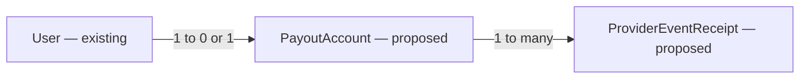

# E02 v2 — Live Stripe Connect onboarding and payout status

Date: 2026-10-29. Status: proposed; production implementation blocked on G2 approval.
Parent: [E02 v2 screen contract](2026-10-29-e02-v2-screenshot-ui.md), screenshots05–07.

## 📝 TLDR
Implement real mentor-only payout setup, enabled and restricted screens with hosted Stripe onboarding and authoritative status refresh/recovery. The user requests a live proposal; no payout UI, provider integration or account state currently exists. This capability does not charge customers, create transfers, issue payouts or claim money was paid.

## Resolved assumptions (autonomous defaults)

- Hosted onboarding keeps identity/bank details at Stripe; DevMentor stores only an opaque account mapping and safe operational status.
- **⚠ NEEDS HUMAN CONFIRMATION:** product owner/maintainer must approve the D02–D04 boundary/amendment, country eligibility, platform business/controller/liability/account model, requested capabilities, currency, pinned API/SDK versions and operations owner before any live account creation.
- SDK/controller/event details below are conditional design responsibilities. Do not choose an irreversible account type from a code sample or model memory. Verify official installed-version/API docs during implementation.

## 📝 Scope, authority and research

Implement `/mentor/payouts` plus the narrow provider lifecycle needed for its real states. No Connect auth/plugin is needed merely to write this spec. Configure live secrets only through approved server deployment settings; no real account or transfer is touched during design.

[Stripe hosted onboarding](https://docs.stripe.com/connect/hosted-onboarding) collects required information and makes account-controller choice consequential. Use server-created short-lived links with authenticated fixed return/refresh paths; never store or email them. [Verification/status guidance](https://docs.stripe.com/connect/handling-api-verification) distinguishes capability and requirement state. [Connect webhooks](https://docs.stripe.com/connect/webhooks) documents event scopes and test/live distinction; subscribe to the approved account lifecycle events appropriate to the pinned account API model. These sources support separating onboarding return from verified status, not a preselected liability/country configuration.

## 📝 Architecture and proposed data model

Core `services/payouts` owns status derivation, current-owner policy and reconciliation behind an explicit `PayoutAccountPort`; server adapter calls Stripe with bounded timeouts. DB owns owner mapping, uniqueness/idempotency and safe snapshot persistence. App owns HTTP/redirect/webhook verification adapters; standalone ui receives safe DTOs. Register by hand in typed Awilix request scopes; no generic integration framework or speculative queue.

Proposed PayoutAccount: UUID id; mentorUserId unique FK User; provider fixed stripe; providerAccountId unique nullable while provisioning; mode test/live; provisioningOperationId unique; connectionState; safe capability/requirements snapshot; checkedAt UTC; createdAt/updatedAt. Provider IDs/status are private operational metadata, not public mentor details. Do not persist bank numbers, birth dates, tax IDs, documents, provider response bodies, secret keys or temporary onboarding URLs.

Proposed ProviderEventReceipt: provider/mode/eventId unique, mapped account reference where known, receivedAt/processedAt/processingState and bounded safe error category; no raw webhook payload. Choose retry/retention bounds before rollout. Event receipt uniqueness alone cannot mark unfinished processing complete. No user-controlled providerAccountId is accepted by an owner route.

An account mapping belongs to a persisted mentor; webhook identity is validated/mapped before any owner snapshot changes. Test/live separation and any mode-specific uniqueness must be settled with the approved account migration model before schema finalization.

## 📝 Commands, API and lifecycle

Proposed owner routes, standard JSON envelopes/no-store and current verified mentor membership:
- GET `/api/mentors/me/payouts`: safe stored status, freshness and available actions; no raw requirements or provider ID.
- POST `/api/mentors/me/payouts/onboarding`: CSRF, bounded empty/explicit body, no owner ID input; idempotently provision/reuse mapping and return a fresh server-validated provider URL. A response URL is transient and never logged or persisted by client.
- POST `/api/mentors/me/payouts/refresh`: CSRF and rate bound; fetch provider state, persist safe snapshot and return current DTO.
- Authenticated return/refresh handlers under `/mentor/payouts`: fixed APP_ORIGIN destinations, no arbitrary callback/redirect URLs. Return triggers reconciliation; refresh creates a new link through the same authorized operation. If session expired, require sign-in then a fresh action, not a transferable secret URL.
- POST `/api/webhooks/stripe/connect`: provider-authenticated bounded raw body/signature/timestamp verification before parse; exempt browser CSRF only because signature is mandatory; reject wrong mode/account/unsupported event scope. Signature helper must not be routed through a JSON parser that changes signed bytes. Do not echo provider errors or payloads.

Provisioning spans remote/local systems and cannot be one DB transaction. Commit an owner operation key under a short lock; call Stripe outside DB lock with the same idempotency key; persist resulting mapping under lock. On timeout/crash retry the same operation; reconcile uncertain results before creating a new operation/account. Concurrent starts cannot create multiple connected accounts. Account-link retries create fresh short-lived links, not duplicate accounts.

Webhook processing and manual refresh serialize per account; use the event as a signal to retrieve authoritative current status so stale/out-of-order events cannot restore an obsolete enabled state. Persist receipt completion only with successful snapshot update, leave failed processing retryable and return appropriate provider retry status. Bound requests and recover from duplicate/crash/unknown-account cases; unknown or wrong-mode input must not attach accounts to arbitrary users. Deauthorization/disconnection transitions safely to unavailable with a recovery path approved for the account model. No hand-rolled polling worker is introduced without a real need; provider retries, manual refresh and a bounded operator repair operation cover recovery requirements.

Proposed optional admin read `/api/admin/users/[id]/payouts` requires current administrator, explicit DTO, audit metadata and no provider impersonation; approve this with G2 before making the screenshot privacy statement that operators can inspect status true. Owners cannot enumerate other owners. Public profile and catalog receive no payout state. Audit events contain category/actor/target/time, never KYC content, link or provider secret.

## 📝 State mapping and UI/UX

State is a safe domain enum plus checkedAt/isStale, primaryAction and humanized non-sensitive requirement categories:
- not_started: no account; Set up payouts action.
- setup_required: incomplete initial onboarding; screenshot05 orange badge, Finish payout setup, requirements panel and Refresh.
- pending_verification: submitted but still under provider review; explicit wait/refresh message, not restricted or enabled.
- enabled: provider confirms payout eligibility and all capabilities needed by the approved platform flow are satisfied; screenshot06 green badge and “does not confirm any transfer has been sent” caveat. Do not conflate charges_enabled with payouts_enabled or successful setup with payment receipt.
- restricted: actionable unmet/disabled requirement or risk restriction according to the approved mapping; screenshot07 red badge, Complete account requirements and safe attention summary.
- disconnected/unavailable/error: safe recovery/retry and last-checked/stale label. Never present an old enabled badge as current after refresh failure.

Finalize precise precedence against approved controller/capabilities/API before implementation; currently_due alone need not mean payout disabled. Unknown provider state fails closed to unavailable rather than inventing eligibility. Test representative provider fixtures for all combinations, not only happy enabled status.

All screenshot sections and navigation are included on one route: heading/intro, state card, setup/recovery/fresh refresh actions, attention or enabled-caveat card, privacy card, back link. Current owner sees status, operators only through approved separate guard. Hosted requirements use fixed external Stripe flow, never identity/bank input fields. Refresh is disabled while pending; failures retain a recoverable UI. Status is announced accessibly, colour is supplementary, keyboard/mobile/dark states match parent visual contract.

## 📝 Risks, compatibility and gates

G2 must record account/controller/liability/capabilities/countries/currency/API-mode model, owner support contact and provider event/retention policy. On-site customer charging and transfer ledger remain separately designed work; onboarding alone must not claim operational settlement readiness. The existing off-site policy stays active until the recorded approval/amendment. An approved live feature gets controlled test→live rollout; no demo flag enables real accounts accidentally.

Additive migrations are tested up/down and refuse dropping persisted mappings/receipts needed for reconciliation. Never delete/disconnect a live provider account as automatic rollback. Disable starts/links and retain safe mappings/status/history on rollback; remote/local uncertainty has an operator runbook. Preserve shared auth/cookies, CSRF, public DTO, role and stable profile URL contracts. Financial/private/provider state makes this risk-high with independent review and QA.

## ✅ Acceptance and Implementation Plan

- [ ] P1: obtain G2 decisions and exact state/API/security contract review. No production implementation is ready before approval.
- [ ] P2: implement mapping/receipt migrations and lazy port/adapter with concurrent/crash-safe idempotent provisioning and bounded provider failures.
- [ ] P3: implement authenticated onboarding/return/refresh and signed mode-aware webhook reconciliation; cover duplicate/stale/invalid-signature/unknown-owner/revoked-role paths.
- [ ] P4: implement all seven state variants and screenshot05/06/07 sections; sandbox end-to-end hosted start/return/expired-link recovery, restriction→enabled and enabled→restricted transitions.
- [ ] P5: owner/operator isolation, public leak checks, secret-redaction tests, schema parity/non-destructive rollback runbook, meaningful 100% production coverage, mandatory gates/four CI jobs and independent browser QA; explicitly approved controlled live enablement last.

No account creation, bank data collection, Stripe transaction or provider configuration change was performed while writing this design.
