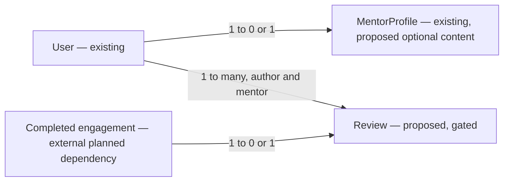

# E02 v2 — Rich public mentor profile and verified reviews

Date: 2026-10-29. Status: proposed; review capability blocked on approval gate G1 and completion-source delivery.
Parent contract: [E02 v2 screenshot audit](2026-10-29-e02-v2-screenshot-ui.md), screen `04-public-mentor-profile.png`.

## 📝 TLDR
Provide the real content behind every section of the public mentor screenshot, then add verified post-service ratings/reviews after explicit product approval. Existing public name/bio/work link/tags remain compatible; illustrative testimonial fixtures never become production data. Content and review delivery have separate implementation milestones so content work need not wait for reputation policy.

## Resolved assumptions (autonomous defaults)

- Use owner-authored bounded plain text; no HTML/Markdown execution, uploaded media, scraped/generated biography or guessed timezone/language.
- **⚠ NEEDS HUMAN CONFIRMATION:** replacing N02, review eligibility/completion evidence, public author identity/consent, moderation/edit/delete/retention and operations ownership require product-owner/Founder A approval. The session owner asked for a live proposal, not automatic activation.
- **⚠ NEEDS HUMAN CONFIRMATION:** the recommendations below are design proposals; required completion source is not implemented. Never add an unverified “verified purchase” badge or accept client-supplied completion.

## 📝 Current surface and proposed content model

`PublicMentorProfile` currently has exactly displayName/publicWorkUrl/bio/stackTags/slug, selected by `toPublicDto` and the db public projection. Preserve it for existing consumers. Add an explicitly separate `PublicMentorProfileDetails` read model/endpoint rather than silently replacing the protected five-key DTO. Existing `/m/[slug]` composes the old profile and optional details, while existing `/api/mentors/[slug]` remains unchanged.

Proposed optional fields on existing MentorProfile, additive migration: `sessionLanguage` bounded language tag (max35; approved display mapping), `mentorTimeZone` validated IANA zone (max100), `helpTopics` max6 ordered `{title:max100, description:max500}`, `sampleAnswer` nullable `{title:max160,intro:max500,codeExcerpt:max2000,body:max10000}`, and `sessionSteps` max5 `{title:max100,description:max500}`. Values are plain text, with an overall bounded JSON request (32KiB maximum); reject duplicates/unknown keys and enforce relevant array/object shapes. Existing bio remains About me and summary source; do not repeat it as invented extra expertise.

`sampleAnswer.body` opens through a real accessible on-page disclosure/read view, not a dead URL. Code is escaped text in a code block. No personal/private session answer can be published implicitly; help text says public content and owner confirms sample ownership before save. Mentor language/zone are explicit owner inputs in an additive “Public profile details” editor section; no automatic inference from browser or IP. Optional sections are omitted when empty; no placeholders implying experience or reviews. Detail completion does not retroactively block previously valid published profiles. Keep name edit in the parent editor issue, not a duplicate implementation here.

Proposed owner GET/PUT `/api/mentors/me/details` and public GET `/api/mentors/[slug]/details`, current-role/no-store/standard envelopes, strict validation, CSRF on writes and explicit DTO allowlists. Public details exist only when the existing verified/current-mentor/published predicate passes. Details readiness must not reveal drafts. Owner omission preserves a value, explicit null clears a nullable value; arrays replace atomically. Unknown fields are 422. Published changes to optional content do not break existing core publication rules.

## 📝 Review model — gated proposal

Recommend one review per completed booking/service engagement by its actual developer participant, after the owning completion service records delivery, no self-review. Do not create a fake Booking entity or accept a bare external URL as proof. Before implementation, approve the exact completion-source contract and trusted migration from off-site service evidence, if any. Without that source the review write API fails closed and the ratings module remains unavailable, never populated from sample names.

Proposed Review entity after gate: UUID id; real engagement/booking FK with unique constraint; mentorUserId and authorUserId FKs; integer rating1–5; body trim/min1/max2000; visibility pending/published/hidden; createdAt/updatedAt; nullable publication/withdrawal timestamps. Recommended initial policy is operator moderation before publication, author withdrawal, no mentor editing/removing criticism, no public author email or user UUID. Product owner must approve author display-name consent and immutable/public name policy before storage implementation. Approval must also set edit window, retention and moderation/report workflow; these are not safe defaults to infer from screenshot dates/stars.

Review aggregate includes only currently published reviews for a currently public mentor, correct count and arithmetic mean; one-decimal display rounding only, deterministic date/id order, paginated list max20. No reviews means “No reviews yet” and no fabricated score/stars. A pending/hidden review contributes neither body nor rating/count. No rankings/catalog scoring is introduced. Moderation/withdrawal updates list and aggregate transactionally or through one authoritative query. Role removal/unpublish hides the full public mentor read while preserving owner data under retention policy.

Proposed routes after approval: POST `/api/mentors/[slug]/reviews` accepts `{engagementId,rating,body,publicNameConsent}` with actor identity from session; GET the same route returns bounded public reviews/aggregate; owner-authored UUID path for withdrawal; administrator-only moderation/report handling must be fully specified and tested before publish. No arbitrary user-supplied mentor/author identity or mass assignment. A review submission flow and moderator workflow are necessary even though absent from screenshot04; define them before implementing live writes. Duplicate/race/self-review/incomplete engagement/role denial are meaningful regression cases.

## 📝 Data model graph

The engagement relation is a required future FK contract, not an entity this spec pretends already exists. Review implementation is blocked until its actual schema and completion authority are accepted.

## 📝 UI/UX and independent delivery

Recreate screenshot04 header/footer, initials hero, real tags, public work, bio, optional language/zone, help topics, sample answer and ordered session-process sections. Reuse the existing public profile component or extend via composition without breaking owner preview callers. The offer sidebar reads actual E02 #6 prices/availability; enable Choose a session only when a real owning booking route can accept it. No new checkout/payment flow here.

Live reputation later adds summary and dated review rows from approved public DTOs, including loading/error/empty/withdrawn/moderated states. Escape free text; long code/body wraps or scrolls locally without page overflow. Screen-reader rating text states value and scale; stars are not the only representation. Capture full-page desktop and 320/390px plus dark mode, including bottom reviews/footer.

## 📝 Risks, policy and research

N02 currently forbids public ratings/reviews; D04 permits post-service feedback but does not alone authorize public publication. Product owner/Founder A must record the replacement and privacy/moderation policy. The owner request is consent to propose, not a substitute for service eligibility or testimonial consent.

[MentorCruise's own reviews policy](https://help.mentorcruise.com/article/72-removing-false-or-fraudulent-reviews-and-ratings) ties session reviews to completed sessions. Adopt a verifiable relationship boundary, not its subscription/operations machinery or a claim that DevMentor has verified outcomes.

Additive migrations require up/down/schema parity and refusal to drop saved public/review content. Existing DTO stays compatible; new endpoints/versioned projections are explicitly reviewed. No public raw identity, payment or invitation fields. Independent review/QA required for scoping/schema changes. Review rollout defaults off until G1 is accepted and completion/moderation evidence exists; C1/C2 content delivery can ship independently under its approved scope and dependencies; rollback disables publication, retaining protected user data according to approved retention.

## ✅ Acceptance and Implementation Plan

- [ ] Phase C1: define strict optional content schema, owner fields, additive migrations and separately allowlisted detail reads; preserve the five-key public DTO and slug.
- [ ] Phase C2: implement owner authoring and every non-review public section with real values, E02 offer dependencies and full-page/mobile stories/browser checks. Public content can ship independently of reviews.
- [ ] Phase R1: obtain recorded G1 decisions; finalize real engagement FK/completion adapter, consent, report/moderation/edit/withdrawal/retention contracts and required author/moderator UI.
- [ ] Phase R2: implement Review persistence/API/aggregate with unique race protection and tested denied paths, then live summary/rows in screenshot04.
- [ ] Phase R3: verify spam/duplicate/self-review/incomplete/wrong-user/moderation/withdrawal and public privacy paths; mandatory 100% meaningful production coverage, lint/typecheck/build/audit/disposable integration, four CI jobs and independent QA.

No review implementation or live content correctness is claimed by this design. Final screenshot04 feature completion requires approved live reviews and real offer/booking dependencies; a C2-only release is labelled partial.
