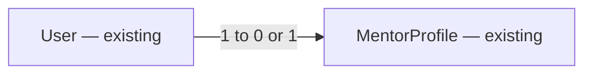

# E02 v2 — Screenshot implementation audit and delivery contract

Date: 2026-10-29. Status: implementation in progress; V2-S01 is implemented on [PR #27](https://github.com/AndreiRymskikh/dev_mentor/pull/27), with dependency audit and independent approval outstanding. V2-S02 code is delivered on [PR #28](https://github.com/AndreiRymskikh/dev_mentor/pull/28), with its mandatory dependency-audit gate and independent review/QA outstanding. Other slices are not implemented by those PRs. Full release is gated on the decisions below.
Authority: all seven owner-supplied `.ai/docs/designs/e02/` PNGs; source audit at `19a59ba`.

## 📝 TLDR
Implement all missing E02 screens and screen sections: invitation entry, first mentor workspace, profile editor, rich public profile, and setup/enabled/restricted payout settings. Reuse working invitations/profile publication and the shared E01 workspace. The owner explicitly requests proposals for **live ratings/reviews and Stripe Connect**, with approval gates; neither feature is silently dropped or treated as already approved.

## Resolved assumptions (autonomous defaults)

- A1 — Reuse current optional invitations, verified self-service enrollment, live multi-role sessions, stable slugs and existing auth. Screenshot invitation-only copy must be corrected; no enrollment-policy migration.
- A2 — Reuse E01 #13 for shared workspace presentation and #16 for mentor-home composition. This spec adds the E02 initial/partial state to that same screen; do not create a duplicate home implementation.
- A3 — Maintain separate capability designs: [public content and reviews](2026-10-29-e02-v2-public-profile-and-reviews.md) and [Stripe payout onboarding/status](2026-10-29-e02-v2-payouts.md). The main spec is the screen-level integration contract, not a combined generic payments/reputation backend.
- A4 — No example identity, review, time, price, completion count or payout status is hardcoded into production. Missing data has explicit empty/error states. Existing Storybook fixtures are not proof of complete pages.
- A5 — **⚠ NEEDS HUMAN CONFIRMATION:** full live delivery requires the product/policy owners to approve replacements for N02's no-public-reviews rule and D02–D04's off-site payment boundary, plus the companion capability decisions. The owner's instruction authorizes writing these proposals, not making those final choices. Keep the design PR draft and dependent issues not ready until recorded approvals exist.

## 📝 Problem and existing implementation audit

The user requests every screen checked and any unimplemented screen added for implementation. This is a source audit, not an authenticated live-browser verification. No inspected screen fully matches its supplied PNG; working backend slices are retained rather than reimplemented.

| Screen and proposed-design evidence | Inspected current source and verdict | Required delivery / owner |
| --- | --- | --- |
| [01-invitation.png](https://raw.githubusercontent.com/AndreiRymskikh/dev_mentor/qa-evidence-e02-v2/e02/01-invitation.png) | `packages/app/src/app/invitation/[token]/{page.tsx,accept-button.tsx}` has real lookup, signed-out return link, matching-account acceptance and mismatch/error states. **Partially implemented:** no full marketing header, hero/two-column invite card, chips, deadline presentation or footer. | V2-S01: implement the entire invitation page and its current-user variants using existing services; retain invalid/expired/consumed generic behavior. |
| [02-first-mentor-workspace.png](https://raw.githubusercontent.com/AndreiRymskikh/dev_mentor/qa-evidence-e02-v2/e02/02-first-mentor-workspace.png) | `mentor/page.tsx` has basic profile checklist/deadline and links. No price/slot persistence, three-step onboarding or full shell/forms/list/share composition. **Partially implemented; screenshot is not complete.** | Extend **existing #16** with this first-workspace/0-of-3 state. Track all sections, not only the heading. Requires E02 #6 prices/availability and E01 #13 shell. |
| [03-profile-editor.png](https://raw.githubusercontent.com/AndreiRymskikh/dev_mentor/qa-evidence-e02-v2/e02/03-profile-editor.png) | `mentor/profile/profile-editor.tsx` has real bio/work-link/tags, drafts, save/publish/unpublish, preview/share/copy. **Partially implemented:** no reference two-column form/share layout, editable display name or exact topic/icon presentation. | V2-S02: migrate the full editor, add explicit display-name support, preserve all existing publication/clipboard/error paths and stable slug. |
| [04-public-mentor-profile.png](https://raw.githubusercontent.com/AndreiRymskikh/dev_mentor/qa-evidence-e02-v2/e02/04-public-mentor-profile.png) | `m/[slug]/page.tsx` and `ui/src/components/mentors/MentorPageView.tsx` expose name/bio/work link/tags only. **Partially implemented:** missing public header/footer, initials hero, language/timezone, offer sidebar, help topics, sample answer, session process, rating summary and all review rows. Existing three basic profile stories do not cover the full PNG. | V2-S03: public layout plus companion content/reviews capability. Price/availability data comes from #6; actual booking navigation depends on the owning booking feature. |
| [05-payouts-setup.png](https://raw.githubusercontent.com/AndreiRymskikh/dev_mentor/qa-evidence-e02-v2/e02/05-payouts-setup.png) | No mentor payout page, Stripe adapter, account mapping, status DTO or webhook was found in app/core/db. **Not implemented.** | V2-S04: live setup/incomplete state, hosted-onboarding action, refresh, requirements guidance, privacy and return navigation. Companion payout gates apply. |
| [06-payouts-enabled.png](https://raw.githubusercontent.com/AndreiRymskikh/dev_mentor/qa-evidence-e02-v2/e02/06-payouts-enabled.png) | No provider-backed enabled-state UI or synchronization found. **Not implemented.** | V2-S04: enabled presentation based on a current verified provider snapshot; notice explicitly says it does not prove a transfer was sent. |
| [07-payouts-restricted.png](https://raw.githubusercontent.com/AndreiRymskikh/dev_mentor/qa-evidence-e02-v2/e02/07-payouts-restricted.png) | No restriction mapping, requirements recovery or fresh provider link flow found. **Not implemented.** | V2-S04: restriction/requirements state, recovery action, refresh/retry, safe requirement summaries and private data boundary. |

## 📝 Scope and compatibility

Existing local epic #6 still owns mentor availability/prices. Closed #7/#8 represent delivered invitations/profile publication, not v2 screen completion; do not reopen them. E01 #12/#13/#16 already track shared shell/home work. New v2 issues cover distinct deltas, not a second auth/profile backend. Historical September issue IDs from another repository are provenance only.

The [implemented invitations](implemented/2026-09-08-invitations.md), [implemented mentor page](implemented/2026-09-08-mentor-page.md), [E01 v2](2026-10-29-e01-v2-screenshot-ui.md), [engineering standards](2026-09-01-engineering-standards.md) and [compatibility contract](../../BACKWARD_COMPATIBILITY.md) remain authoritative for unaffected behavior. This spec proposes E02 visual replacement for the September handoff; product-policy supersession is conditional on approval, not accomplished by merging design prose.

No video, on-site conversation/notes implementation, calendar sync, subscription, search ranking, payment charging/transfers/refunds or arbitrary user CRUD is added. Live payout **onboarding/status** is a distinct capability from collecting customer money. Booking, cancellation and post-service completion remain externally owned dependencies. Full screenshot delivery may not be declared complete with fake reviews, static payout badges or inert price forms.

## 📝 UI/UX

### 01 — Invitation
Public header with brand and account-aware navigation; desktop hero and invitation card; duration/written-answer chips; calendar/deadline explanation; footer. Stack content at 320/390px without clipping. Anonymous CTA preserves the exact allowlisted `/invitation/<43-character-token>` login continuation; registration/recovery must not lose the invitation. Preserve the existing redirect guard rather than allowing arbitrary return URLs. On register/verification interruptions, retain only this validated continuation in first-party transient state and test the full return; never put raw tokens in analytics/logs.

Authenticated matching verified user sees Accept; mismatch explains account switching; acceptance pending prevents duplicates and success reaches `/mentor` using the same original session. Invalid/expired/revoked/used links retain generic safe feedback. Do not expose more invited-email information than the existing contract permits. Display the configured publication window and actual persisted deadline, not a hardcoded 14 days if configuration differs. Replace the invitation-only footer claim with truthful optional-invitation/self-service copy.

### 02 — First mentor workspace
Use the exact same mentor-home composition as E01 #16, showing “Get ready for your first session”, 0/1/2/3 completed steps, deadline badge, profile/prices/time links, price-bound chips, both forms, empty available-times card and unpublished/share area. Keep the full lower-page composition. Invitation's write-once `initialPublishDueAt` remains distinct from a later acceptance's `publishDueAt`; self-service mentors may have no deadline. Expiry does not automatically revoke a role without an approved rule.

Checklist reflects real publication, both persisted valid prices and qualifying published availability according to owning services. No false “3 of 3” while requests are pending. Keep stale/failed data distinct from empty. UTC-labelled wall-clock input is converted as UTC, not as machine local time; replace demo clock with actual service time. Current price bounds and slot publication lead discrepancy must be recorded/approved under #6 before enabling their forms. Preserve the first-home state as part of #16, with this PNG added as durable evidence.

### 03 — Profile editor
Workspace shell, page title/description/published badge, left editor and right share card. Fields: display name, mentoring description, public work URL, technology/topic icon chips. Right-aligned Cancel then Save; keep draft/publish/unpublish operations accessible, including when absent from PNG. Topic selections use existing controlled vocabulary and max-four unique tags. Inline hints/errors and first-error focus; preserve unsaved values on failure and reset only on explicit Cancel. Unpublish is reversible; editing cannot silently invalidate an already-published page.

The screenshot's display name is currently read-only backend data. Proposed extension: optional `displayName` on `PUT /api/mentors/me`, trim/min1/max100 matching `register.schema.ts`; an authenticated current mentor edits their **account-wide User.displayName**, explicitly explained in help. Persist User/profile changes atomically in the existing user-lock transaction; reject unknown fields, preserve omitted name, never change identity, email, roles or slug. `MentorProfileRepository.mutate` currently copies name to a record but does not persist it: updating only the DTO is not completion. Test account/admin/public consumers, rollback and concurrent membership removal. If owner requests a separate mentor alias, stop and amend the model first.

Share URL uses actual configured origin and `/m/<stable-slug>`, never screenshot localhost/prototype URL. Published link preview and copy are real; draft explains why no public link exists. Clipboard denial after success must clear old success and offer selectable text. Unpublish preserves slug; public view becomes unavailable; local owner preview remains private.

### 04 — Full public profile
Implement the **entire long image**, not just the first viewport: public header; initials/name/stack hero; summary; language/timezone; public work; About me; “What I can help with”; sample-answer card/code excerpt/read action; “How I run a session” steps; rating summary; “What mentees say” rows with dates/stars; footer; offer sidebar with 25/50-minute price, availability and choose-session action. Companion content/reviews spec defines real sources and approval gates. No fabricated timezones/languages or generated testimonials.

Offer sidebar reads validated E02 prices/availability; missing price/time disables booking with a reason. Enabled booking action requires an existing owning booking route—never point to a 404 or pretend a reservation was made. UI can show valid public availability without delivering booking. Full booking-enabled screenshot behavior remains a dependency, not a reason to build a second booking service here. Public reads never include email, invitation data, private session notes or Stripe account/status fields.

### 05–07 — Payout settings
Implement one `/mentor/payouts` route with real status-driven states from the companion design: not started, setup/incomplete (05), pending verification, enabled (06), restricted (07), unavailable/error and disconnected. Include all screenshot sections: account badge, headline/help, primary setup/recovery, Refresh status, requirements panel when needed, enabled caveat, privacy panel and back-to-workspace link. Current mentor owner only; approved operators get a separate audited allowlisted status read, not arbitrary owner-route impersonation. No banking/identity inputs or financial documents are collected by DevMentor.

Provider return never implies success. Refresh/reconcile reads authoritative provider state; do not parse status from query strings. Pending/failed refresh cannot keep a false enabled badge; show last checked/stale or unknown state. The same approved status projection later enables E01 payout labels, but no public profile receives it.

### Shared visual and accessibility contract
Reuse E01 #13 frames, shared controls/panels/forms/tables and semantic token palette. Grey page/white cards/blue actions, neutral text, pale selected chips; contrast-tested success/warning/danger tokens and dark equivalents. No literal palette utilities in consumers. Match reference hierarchy/spacing and approximate 272px sidebar/80px top bar; cards adapt to content. Desktop 1440px, 768px and mobile 390/320px; long public page and sidebar stack coherently, no document overflow. Label icon actions, errors/status updates, keyboard focus, mobile drawer, external-link purpose and disabled-action explanations. All role navigation remains additive/current-authorized.

## 📝 Architecture and data model

Preserve app → core → db and standalone ui, explicit typed Awilix composition, lazy request-scoped persistence and scope disposal. Use current `apiHandler`, bounded Zod shapes, typed errors, CSRF on browser mutations, `apiCall`, existing forms/fields/feedback. Read installed Next docs before implementing route/layout changes. No discovery framework, generic provider registry or speculative queue.

Main spec extends only an existing display-name mutation; no new main-spec entity. Rich profile additions and reviews have their own model/compatibility plan; payouts have a separate bounded owner/provider model. The root spec does not authorize their migrations before gates pass. Keep private/public DTOs separate and coordinated under BACKWARD_COMPATIBILITY.md; update all consumers and unit/API/browser tests together.

The editor writes the existing user's name; publication slug remains on the existing profile. New capability entities are diagrammed only in their owning companion specs.

## 📝 Approval gates and risks

- G1 — Product decision owner/Founder A records a replacement for N02 before production public reviews; agree eligibility/completion source, public author identity/consent, moderation/report/delete/edit/retention rules. Merely requesting the proposal does not settle these.
- G2 — Product owner and maintainer approve live Connect onboarding/status within the off-site-payment boundary or record an explicit D02–D04 amendment; approve account controller/liability/country/currency/capabilities/API version and operations owner. No live account is created during design.
- G3 — Existing E02 #6 owns price/currency policy and availability boundary reconciliation. E01 #16 remains home implementation owner.
- G4 — Public profile content provenance and booking/completion dependencies are explicit in its companion. No field is fabricated to match the PNG.

Implementation is risk-high when touching public/private projections, identities, ownership, financial/provider state or migrations. Requires independent review, negative ownership tests, disposable DB migration up/down/schema parity, browser QA and safe rollback. UI rollback restores old consumers; additive data/schema stays if destructive down would lose user content. Do not rename existing routes, roles or share slugs. Public rollout of gated modules remains off until approved and verified; no migration is a policy-approval substitute.

## Delivery ownership and verification boundary

New V2-S01 owns invitation UI only; V2-S02 owns editor UI and explicit name mutation; V2-S03a owns optional public content persistence/authoring/details projection and the non-review public layout; V2-S03b owns the gated review backend, author/moderator workflows and public rating/review sections; V2-S04 owns the payout backend and all three payout screen states. Companion specs define these same tasks; they are not extra backend implementation issues. Existing #16 remains the sole mentor-home implementation issue.

Booking/completion is a separate externally owned dependency. No local booking implementation issue or accepted completion-source contract was found in this audit. A related **design dependency issue** must name the product owner/maintainer as decision roles, settle booking destination and trusted completion evidence, and produce a separately reviewed booking specification plus implementation issue before dependent delivery starts. Full screenshot04 completion requires a functioning authorized booking destination and approved completion-backed reviews. A disabled Choose a session is a truthful intermediate state, not full delivery.

“Production browser evidence” here means the real production-built application process against disposable fixtures, using Stripe test mode for automated/sandbox flows; it does not mean testing financial operations on live customers. Final production enablement requires a separate explicit approval by the product owner/maintainer and an operator-run test/live checklist; this design run performs neither live onboarding nor financial transactions.

If an approval gate is rejected, the feature remains incomplete against these requested screenshots until the owner approves an explicit revised scope, screenshot adaptation and acceptance update in this spec/issues. Rejection does not silently remove reviews, payouts or booking from completion criteria. Each ungated slice may still ship independently and be reported as partial.

## ✅ Acceptance criteria

- AC1: all seven exact PNG filenames have audit verdict, route/state, issue owner, deterministic story and production browser evidence. Partial backend delivery does not close screen work.
- AC2: invitation entry/acceptance matches 01, retains original-session/current-role/token/continuation security and configured deadlines.
- AC3: existing #16 implements 02 alongside E01's completed-home reference; live setup progress/forms/empty states are proven against actual E02 APIs.
- AC4: editor 03 matches composition and persists all supported inputs including name atomically; publish/unpublish/share/clipboard failure and slug stability remain correct.
- AC5: public page 04 includes every lower-page section and real content; gated reviews/offer dependencies must be live and verified before full-feature sign-off. Interim layout completion is explicitly partial.
- AC6: 05/06/07 are real provider-backed states with setup/return/refresh/recovery and no data leaks; no static/demo status substitutes.
- AC7: Storybook covers all seven references, light/dark, default/long/loading/error/pending/denied/empty plus relevant lifecycle transitions. Existing three profile stories are insufficient.
- AC8: meaningful 100% production TS/TSX coverage, lint/typecheck/build/audit/disposable integration and all four required CI jobs pass; independent QA/review for high-risk work. Capture desktop and mobile full-page comparisons, including the long public profile.

## 📋 Phasing and Implementation Plan

Each issue includes tests and a working incremental route. Gates block dependent capabilities, not independent invitation/editor work.

### V2-S01 — Invitation screen
- [x] Step 1: consume public framing and implement complete screenshot01 without replacing invitation services.
- [x] Step 2: preserve anonymous/register/verify/login return, matching/mismatch/invalid/used/pending/failure states; exercise same-cookie acceptance and configured deadline in isolated tests.

### Existing E01 #16 — First and completed mentor workspace
- [ ] Step 3: add screenshot02 as an additional state/acceptance target to #16, link this spec; do not file a second mentor-home issue.
- [ ] Step 4: owner of #6 delivers approved price/slot contracts; #16 consumes them and verifies 0/partial/3-step and empty/list/share states.

### V2-S02 — Profile editor
- [x] Step 5: migrate two-column form/share composition and technology chips; retain all publication controls.
- [x] Step 6: extend strict owner schema/repository transaction for explicit account-wide display-name edit; preserve old callers/slug, tests and privacy boundaries.
- [ ] Step 7: prove save failure/input retention, publish/unpublish, copy success→denial and role revocation; full stories/browser comparisons.

### V2-S03a / V2-S03b — Public content/layout and gated reviews
- [ ] Step 8: implement approved companion content sources, optional bounded fields and owner authoring; no canned public data.
- [ ] Step 9: compose every section of 04, integrate actual E02 offer data and owning booking destination when available.
- [ ] Step 10: only after G1/completion dependency, implement live reviews and tested public projection; until then record the page as incomplete for full screenshot delivery.

### V2-S04 — Live payout onboarding/status
- [ ] Step 11: obtain G2 decisions and detailed companion spec review before any live integration/migration.
- [ ] Step 12: implement adapter/mapping/idempotent onboarding and signed webhook/reconcile owner contracts; sandbox provider acceptance first.
- [ ] Step 13: implement all 05–07 states/requirements/privacy/actions and owner/operator isolation; verify stale/return/error/recovery paths before controlled live enablement.

### Final all-screen milestone
- [ ] Step 14: verify traceability for all seven images and the specific prerequisite deliveries from #6/#13/#16, without requiring or closing unrelated epic scope; production gates/CI, full-page screenshots, accessibility and independent QA evidence. Do not mark whole E02 v2 implemented while any required screenshot capability remains blocked or mocked, unless an explicit owner-approved scope/acceptance revision has replaced it.

## Review limits

Design/source inspection only; no fresh runtime tests or live provider operations performed. Shared test-environment descriptor is absent; provided PNGs are proposed-design evidence, not current-app screenshots. Model/contract proposals require implementation validation. New screenshot policy requests are explicitly proposals, leaving protected product decisions unchanged until approved.

Fresh-context scope review completed: clarified booking completion/ownership, split content versus review implementation ownership, rejection behavior, test-mode versus live evidence and bounded cross-epic obligations. No reviewer result is claimed as runtime QA.

## Related implementation and dependency issues

Design PR: [#18](https://github.com/AndreiRymskikh/dev_mentor/pull/18), draft pending G1/G2.

- [#19 — E02 v2: Implement all seven screenshot-defined mentor screens](https://github.com/AndreiRymskikh/dev_mentor/issues/19)
- [#20 — E02v2-S01: Implement the full invitation landing and acceptance screen](https://github.com/AndreiRymskikh/dev_mentor/issues/20)
- [#21 — E02v2-S02: Implement the profile-editor screenshot and real display-name saving](https://github.com/AndreiRymskikh/dev_mentor/issues/21)
- [#22 — E02v2-S03a: Implement rich public-profile content and the complete non-review layout](https://github.com/AndreiRymskikh/dev_mentor/issues/22)
- [#23 — E02v2-S03b: Implement approved completion-backed public ratings and reviews](https://github.com/AndreiRymskikh/dev_mentor/issues/23)
- [#24 — E02v2-S04: Implement live payout setup, enabled and restricted screens](https://github.com/AndreiRymskikh/dev_mentor/issues/24)
- [#25 — E02v2-D01: Specify the booking destination and trusted service-completion contract](https://github.com/AndreiRymskikh/dev_mentor/issues/25)

Existing [#16](https://github.com/AndreiRymskikh/dev_mentor/issues/16) receives the screenshot02 first-workspace addendum; #13 provides the shared shell and #6 prices/slots. New issues do not duplicate these. #25 owns booking/completion specification discovery before dependent implementation. #23/#24 are explicitly not ready at their policy gates.
