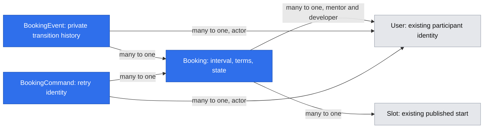

# Booking destination and trusted service completion

Date: 2026-11-08. Status: accepted contract (merged PR #39; #25 completed). Implementation is tracked in [PR #42](https://github.com/AndreiRymskikh/dev_mentor/pull/42); independent high-risk sign-off, production launch operations and #38 full lists remain separate. Source: [#25](https://github.com/AndreiRymskikh/dev_mentor/issues/25). Implementation owner: [#37](https://github.com/AndreiRymskikh/dev_mentor/issues/37); participant screens: [#38](https://github.com/AndreiRymskikh/dev_mentor/issues/38). Product decision owner: session owner; technical acceptance: repository maintainer/reviewer.

## TLDR

Developers will book a mentor's published time immediately, without mentor approval. A real booking owns its interval, agreed price and private history; either participant can cancel with a reason until the developer confirms completion. The public offer will link to an authenticated booking destination only after #37 delivers it; this document enables neither booking nor public reviews.

## Decisions in play

[D05](research/decisions/D05-immediate-booking-and-completion.md) supersedes D04's mentor-approval requirement. The owner explicitly accepted immediate booking, atomic rescheduling, reason-required cancellation before completion (including during/after scheduled service), private cancellation history visible to both participants and current administrators, developer-only completion, and six-month retention. No mentor action is needed for completion.

Preserve [D02](research/decisions/D02-mvp-booking.md)/[D03](research/decisions/D03-availability-and-feedback.md)/remaining [D04](research/decisions/D04-booking-support-feedback.md): external text service, payment directly to the mentor and external support. R01 preserves 25/50-minute sessions; R02/N01/N02 remain active. Public cancellation history, reputation penalties, on-site payment/refunds, chat, calendar sync and public ratings are excluded. #23 still requires its separate G1 approval and actual completed bookings.

## Problem and current evidence

`m/[slug]/public-offer.tsx` presents saved prices but explicitly says booking/payment are unavailable. Existing Slot records contain a start and historical removal marker, not occupied duration. Unique starts cannot prevent a 50-minute session overlapping a nearby distinct start. No booking entity or completion authority exists in the inspected db/core tree. #37 already owns implementation; do not introduce an E02-owned parallel schema. #36 catalog and #38 full sessions workspace remain separate deliveries.

## Research and alternatives

[Cal.com FAQ](https://cal.com/faq) exposes cancellation and rescheduling from the booking/account and confirmation-email journey. Adopt the discoverable booking-detail actions; do not import provider workflows, email-link mutation authority or calendar synchronization. DevMentor's accepted cancellation cutoff is completion, not session start.

[PostgreSQL 18 range documentation](https://www.postgresql.org/docs/18/rangetypes.html) models intervals and exclusion constraints for overlapping reservations. Use half-open intervals so back-to-back sessions can coexist. For this MVP, use the existing user-first locking mechanism plus indexed conflict checks under that lock; a separate capacity table/extension is unnecessary. This is an implementation choice, not a claim that a simple unique slot constraint prevents overlap. Every writer, including reschedule and slot removal, must share the lock contract below.

## Architecture

Add the `bookings` concept inside existing layers: db entities/repository/migration, core pure validators and BookingService, app API/page wiring. Compose it explicitly in the typed request-scoped Awilix cradle; lazy db initialization preserves build/boot without PostgreSQL. Authentication sessions remain in the existing `sessions` concept and are unrelated.

Core owns eligibility/transitions; db owns atomic persistence and locking; app authenticates, checks CSRF and invokes the service; standalone ui receives pure schema/DTO props. Reuse `apiHandler`, no-store standard envelopes, `apiCall`, CrudForm/DataTable/feedback. Dispose scopes in finally. No event bus, worker queue or payment adapter is required. Durable BookingEvent rows are the audit, not application logs or best-effort observers.

## Data Model

All names below are proposed new entities; User and Slot already exist. Use explicit snake_case ORM field names, UUID FKs, additive MikroORM migrations and guarded down. No copied email, credentials, session content or external payment evidence.

| Entity | Required fields and constraints |
| --- | --- |
| Booking (`bookings`) | UUID id; developerUserId/mentorUserId → User, distinct; slotId → Slot; startsAt/endsAt UTC; durationMinutes 25 or 50; priceCents positive integer, currency PLN; status `booked/cancelled/completed`; version positive integer; createdAt/updatedAt; nullable cancelledAt/completedAt; retentionExpiresAt. EndsAt equals startsAt plus duration. State and terminal timestamps must agree. Participant identities, duration and price/currency are immutable. |
| BookingEvent (`booking_events`) | UUID id; bookingId FK; actorUserId FK; kind `created/rescheduled/cancelled/completed`; version and occurredAt; strictly typed old/new slot/time for reschedule; required trimmed reason 1–1000 characters only for cancellation. Unique (bookingId, version); append in the same transaction as the transition. No arbitrary JSON or raw request payload. |
| BookingCommand (`booking_commands`) | UUID id; actorUserId FK; request UUID; operation; canonical input digest; bookingId FK; resulting version and createdAt. Unique (actorUserId, requestId). Retain with booking; no raw body or reason copy. Provides retry identity, not authorization. |

Booking FK deletion uses restrict for participants and slots; deleting an account/profile/slot cannot silently erase booking history. Current Slot's cascade from mentor profile must not bypass this restriction. No user/profile destructive-delete feature is added. Events/commands may cascade only through the explicit retention purge of their booking.

Indexes: (mentorUserId, startsAt), (developerUserId, startsAt), (retentionExpiresAt, id), (bookingId, version), and command uniqueness. Conflict query uses indexed participant/start predicates and an existence/limit-one result; never load all history. Migration checks enforce finite valid dates, duration/price/state and participant inequality. Domain services additionally enforce slot ownership and price eligibility.

One booking is the engagement identifier for future feedback; events and retries cannot create another obligation.

## Lifecycle and authorization

Every operation resolves a current verified session. Developer membership is required to create a booking; current verified mentor membership/publication is required for the target. Self-booking is forbidden. Existing participants retain private read/cancel/confirm rights after mentor membership removal or profile unpublication; these changes block new bookings and rescheduling, not existing obligations. A mentor remains unable to confirm completion. Current administrators can read private history through a separately guarded admin read endpoint, but cannot impersonate participants, cancel or manufacture completion.

| Operation | Actor / precondition | Atomic result |
| --- | --- | --- |
| Create | Verified developer, other currently published verified mentor, valid current prices and eligible active slot | `booked` immediately; reserve full interval, snapshot terms, event and retry record |
| Reschedule | Booking's developer; `booked`, before its current start; same mentor/duration, eligible new slot | Replace slot/start/end under one transaction; preserve id, participants and agreed price. Record old/new times; rollback keeps original unchanged. No mentor approval. |
| Cancel | Either participant; `booked`, at any clock time before completion | Require reason; `cancelled`, event with actor/time/reason, release capacity. During/after scheduled end is allowed. |
| Complete | Booking's developer; `booked`, server time at/after endsAt | Explicit “I confirm the mentor provided the service”; `completed`, event and timestamp. No mentor action, automatic elapsed-time completion or payment assertion. |
| Read | Either participant or current administrator through its own guarded endpoint | Private DTO/history; unrelated, malformed and missing IDs return indistinguishable 404 |

No pending, approve, decline, no-show or automatic-completion state. A past `booked` row displays “Awaiting your confirmation” for the developer and “Awaiting developer confirmation” for the mentor. It is not evidence of delivery. Cancelled/completed are terminal; no general reversal or completion-correction endpoint is authorized. A completion mistake goes to configured external support; correction policy requires a separately accepted audited design before any data edit. Future feedback must consult current persisted state, not an event cached by a client.

### Capacity and races

For a matching retained retry, reconcile first as specified below; the following sequence applies only to a new transition.

1. Obtain immutable participant IDs from the candidate booking/slot, then lock all affected User rows in ascending UUID order before profile/slot/booking rows. After acquiring participant locks, repeat the authorized command lookup before any version, capacity or other transition checks: two concurrent retries may both have missed the initial lookup before one waited for the winner to commit. The waiter must return that same booking/applied version as a replay. For a new mutation, re-read the booking and verify identities/version only after this second lookup. Existing role/profile/slot writers already acquire the relevant User first. Do not acquire a second user while holding a later-order profile/booking lock.
2. Recheck current identity/membership, publication, selected slot ownership/removal, policy and server time *after* locks. Create/new reschedule target must satisfy the existing inclusive two-hour lead and six-UTC-month publication horizon. Rescheduling after current start is not added; cancellation remains available until completion.
3. For each participant in either capacity (mentor or developer), reject any other noncancelled booking with `existing.start < proposed.end AND existing.end > proposed.start`. Exclude the booking being moved. Prevent cross-role overlap too. Under user locks all competing create/reschedule writers serialize. Half-open intervals permit an end equal to the next start.
4. Slot removal under its existing mentor User lock does not cancel bookings. It blocks new use of that start, while existing bookings remain readable/cancellable/completable with snapshotted times. Unpublication, role loss and price/policy changes similarly do not erase agreed obligations. Released capacity is bookable only if the underlying slot remains active and eligible.
5. Persist booking, event and command together. Return the response projection captured inside the transaction; a post-commit observer or refresh failure must not misreport a committed booking as failed. Cancel versus complete, two reschedules and create versus removal have one winner; stale version is 409.

### Money and retries

Create carries expected integer price/currency to prevent silent stale-price acceptance; actual price comes from the locked current policy/profile, never the request. Reject differences with 409 and require a new explicit review. Rescheduling preserves original price for the same duration even if current mentor prices change, but the new offer must still be valid under current policy. Changing mentor/duration is cancel/rebook, not rewriting terms.

Every mutation carries a fresh UUID requestId, reused only for retries of that attempt. The command uniqueness/digest covers operation, target, version and canonical values. Same actor/key/input returns current authorized booking DTO plus the original applied version and `replayed:true`, with no repeated transition. Reusing a key with different input returns409. After authentication/CSRF, look up the command and check current booking ownership/retention before any new-transition eligibility check (including version, publication, slot removal, prices, role eligibility and clock). A matching retained command returns its authorized current DTO even if those mutable conditions now reject a fresh action. No stale private response is stored. Concurrent command-key uniqueness conflicts roll back the losing transaction completely, then reconcile through this same authorized replay lookup; do not convert an already committed command into a new attempt. Client keeps the same key after timeout/unknown outcome until it reconciles, and creates a new key only for a changed intent. Purged command keys do not resurrect records; expired create retries cannot pass future-slot validation.

## API Contracts

Additive dynamic routes use `apiHandler`, bounded 8KiB strict JSON, CSRF with configured APP_ORIGIN, no-store standard envelopes and canonical UUID validators. No client selects actor, arbitrary state, completion timestamp or price to persist. Expected auth/CSRF errors follow existing conventions; malformed/oversize body400, validation422, missing/unowned404, conflicts409, unavailable dependencies503.

| Endpoint | Input / response data |
| --- | --- |
| `POST /api/bookings` | `{mentorSlug,slotId,durationMinutes,expectedPriceCents,currency:"PLN",requestId}` →201 `{booking,appliedVersion,replayed:false}`; replay200 |
| `GET /api/bookings/[id]` | Participant booking + events + authoritative allowedActions/serverNow; no identity supplied in query |
| `GET /api/bookings` | `view=upcoming/history` (default upcoming), limit1–100 default25, after cursor → `{items,nextCursor,serverNow}` |
| `POST /api/bookings/[id]/reschedule` | `{slotId,expectedVersion,requestId}` →200 mutation result |
| `POST /api/bookings/[id]/cancel` | `{reason,expectedVersion,requestId}` →200 mutation result |
| `POST /api/bookings/[id]/complete` | `{confirmation:true,expectedVersion,requestId}` →200 mutation result; authenticated owning developer only |
| `GET /api/admin/bookings/[id]` | Current administrator only; private booking/events; no arbitrary state mutation |
| `GET /api/mentors/[slug]/booking-options` | Public bounded duration-specific options: duration25/50, limit1–100 default50, after; `{bookingAvailable,slots:[{id,startsAt,bookable,reason}],nextCursor,serverNow,refreshAt}`. No booking IDs, participant data or cancellation reasons. |

Private BookingDto allowlists id, counterpart `{displayName,mentorSlug?}`, actor-relative role, selected interval/duration/agreed price/currency, state/version, createdAt/cancelledAt/completedAt/retentionExpiresAt, allowedActions, and external handoff. Events expose actor role/name, time, transition and reason only to authorized viewers. Do not expose email, internal User IDs or idempotency digests. Lists omit event bodies; detail supplies bounded event pages (limit25, max100, ordered by version) with next cursor. Unknown parameters/cursors fail422; cursors confer no authority.

Upcoming = booked with endsAt > serverNow, ordered (startsAt,id) ascending. History = terminal or endsAt <= serverNow, ordered (startsAt,id) descending; past unconfirmed bookings remain actionable in history. Cursor includes view/order and last tuple; refresh begins at page one after transitions. Exclude expired-retention records consistently in detail/list/admin reads even if purge is delayed. #38 uses this projection in the authenticated account/profile workspace; no public history component.

Preserve existing public profile, `/slots` and `/offer` DTOs, including `bookingAvailable:false`; they currently describe preparation rather than duration-specific occupancy. The new booking-options endpoint supplies actual booking eligibility and a separate capability flag. Migrate the public CTA consumer in #37 to it; never reinterpret existing `eligible` as capacity. Options re-evaluate overlaps server-side, and can still lose a race at submission. Unknown/past/removed slots cannot be selected by bypassing the UI.

## UI/UX and handoff

Proposed destination: `/book/[mentorSlug]?slot=<uuid>&duration=25|50`. Query parameters carry intent only; server revalidates every field. The public page uses real duration-specific options and links only after the capability exists. Anonymous visitors can reach public information; booking submission requires login. Extend the current invitation-only login continuation with a separate exact booking-route parser and bounded first-party continuation; never enable arbitrary return URLs or regress invitation continuation. Test login/registration/verification interruptions and expired/stale intent. No booking occurs on GET or immediately after authentication.

The review screen shows mentor, explicit viewer zone plus UTC, duration, agreed PLN price and external-service guidance. “Book session” creates one immediate confirmed reservation. A successful response goes to `/account/bookings/[id]`, an initial detail/action destination delivered by #37 independently of #38's full list. Refresh/retry uses authoritative records; timeout says outcome unknown and reconciles with the same requestId. “Slot no longer available” preserves context and offers fresh options; no optimistic success. Missing prices, unpublished mentor, no eligible free options, policy outage and missing handoff configuration have distinct disabled/error explanations.

Cancel presents a required plain-text reason with a warning not to include sensitive information. After success, private detail/profile history shows who cancelled, when and why; never add a public badge, count or penalty. Both participants and current administrators can read it. Completion prompts appear in private detail/history only after the scheduled end, with “Confirm service received” and an explicit confirmation dialog; dismissing the prompt leaves booked unchanged. Cancel remains visible until completion. Reschedule review shows former/new times and the unchanged agreed price; a conflict preserves the former booking.

Use existing workspace controls, inline field errors, focusable success/error feedback and accessible dialogs; verify keyboard, 320px layout, dark/light themes and timezone/DST rendering. #38 adds role-aware lists/navigation using these same actions; mentor approval controls must not appear.

### External service and support launch inputs

Payment and text session are arranged externally; no paid/refunded label or claimed payment verification. Add required lazy server configuration `BOOKING_SESSION_GUIDANCE` (plain text,1–2000 chars) and `BOOKING_SUPPORT_URL` (validated HTTPS or mailto, no embedded credentials/header injection). Deployment maintainer supplies the real participant contact/channel instructions and accountable support destination before launch; do not invent a personal contact or use optional publicWorkUrl as the only handoff. Expose only these deliberate instructions in review/detail. Missing/invalid values make new booking unavailable with503; existing history/cancel/complete must remain operable, displaying support unavailable if needed. No external API call is on a booking transaction path. No automated reminder or email delivery is required by this design; prompts refresh on detail/list reads.

## Retention and privacy

Owner accepted six months; proposed precise rule: `retentionExpiresAt = addSixUtcCalendarMonths(max(scheduled endsAt, terminal transition time if any))`, preserving UTC time and clamping month-end. Reschedule recomputes against its new end; idempotent replays/reads never extend retention. Unconfirmed past bookings expire six months after their end instead of remaining forever. Cancel/complete reject expired records; missing completion never auto-grants feedback.

Add bounded operator command `bookings:maintain`, explicit DATABASE_URL, max500 expired bookings per invocation with row locking/skip-locked and timeouts. Atomically delete events, commands and bookings; emit only aggregate deletion counts, no actor/reason. Deployment schedules it daily and alerts on failure; reads hide expired data immediately. Authentication maintenance remains unchanged. No raw body/reason in request logs, analytics or error output. Reason text renders escaped; authorization and private cache policy apply to exports/admin too. Backups containing booking data must expire on a documented bounded cycle (proposed30 days); restore procedure reruns retention before serving traffic. Six months describes live-record availability; disclose backup expiry separately in deployment/privacy documentation before launch.

Future #23 must define its own review-retention interaction before adding an FK: no permanent review may silently force longer booking/event retention, and purge must not destroy a separately approved public-review record by cascade. This spec supplies a completed-engagement read contract, not review consent or immutable proof of external delivery.

## Failure modes, reversibility and limits

- Completion authority is the authenticated developer's statement, not independently observed delivery. UI must say developer-confirmed, never verified purchase. No mentor boolean, elapsed clock or public review request can set it.
- Completion/cancellation races lock the same booking; winner commits one terminal event, loser409. Retries never append a second event. Admin role loss immediately removes admin access.
- DB failure rolls back capacity, event and command together. Failed reschedule retains original. Current-role/profile changes serialize with booking checks; existing obligations remain private and manageable.
- Operator mistakes do not justify undocumented direct SQL correction. A reversal contract, external automation or review publication needs separately reviewed scope; preserve terminal audit until retention.
- Additive migration before application rollout; test up/down on empty disposable PostgreSQL and ORM schema parity. Down locks affected tables and refuses any booking/event/command. Application rollback retains schema/history; do not delete data to make down pass.
- No runtime UI evidence is claimed by this document. Mockups/current-app captures are skipped because no shared test-env descriptor exists. Static model diagram is design evidence only.

## Resolved assumptions (autonomous defaults)

Owner choices above are explicit decisions, not autonomous defaults. Remaining technical proposals are visible for review: developer rescheduling only before current start; same duration/price; retention anchor based on later scheduled end/terminal transition;30-day backup expiry; private in-app prompts rather than email; user-lock serialization rather than a new exclusion-extension schema. These do not amend N02 or introduce payment verification. Real service/support configuration and retention operations are launch prerequisites owned by deployment maintainer; no fabricated contact is supplied.

## Phasing

1. Contract acceptance and owning issue alignment (#25): this design, D05 and reviewer feedback; no production code.
2. Booking engine and real direct-profile journey (#37): persistence, immediate creation, participant/admin reads, atomic changes/cancellation/completion, private detail/history, launch configuration and retention operations. Can ship without catalog or full lists.
3. Full My sessions (#38) and separate catalog (#36): consume existing contracts; no duplicate lifecycle. Public reviews (#23) remain independently gated by G1 and actual #37 completion delivery.

## Implementation Plan

Every production step requires meaningful100% per-file lines/statements/functions/branches, lint/typecheck/build/audit and applicable disposable PostgreSQL/browser checks. Finish build before starting its immutable production test process; never touch developer database volumes. CI's four checks must independently pass before any merge.

- [x] Step1: record owner answers and supersede D04 approval in D05/product brief; define route, lifecycle, owning #37 and #38 consumers.
- [x] Step2 (#25): independent scope/security/contract review and maintainer design acceptance; link reviewable owning issues. Accepted through merged [PR #39](https://github.com/AndreiRymskikh/dev_mentor/pull/39) and completed #25. Merging this document does not implement #37 or close the parent E02.
- [ ] Step3 (#37): entities/migration/repository with guarded rollback, strict validators and request-scoped composition; prove real ORM persist/read, schema parity, event/command atomicity and interval concurrency across differing durations and cross-role participants.
- [ ] Step4 (#37): create/read/options APIs, retry and current-role/CSRF protections; real review/detail destination and safe auth continuation. Prove stale price, removed/expired slot, exact lead boundary, self-booking, replay mismatch, denial, command-key concurrency (including both retries missing the first lookup and the waiter reconciling after participant locks), retries after slot removal/unpublication/price change/elapsed start and unknown-outcome reconciliation in production HTTP/browser.
- [ ] Step5 (#37): reschedule/cancel/complete APIs and private detail/history/admin read. Test cancel during/after end, reason validation/escaping, wrong participant, current admin revocation, post-completion rejection, cancel/complete races, failed move preservation, historical price preservation and no mentor completion control.
- [ ] Step6 (#37): bounded retention command and deployment runbook; exact six-month/month-end/late completion boundaries, unconfirmed expiry, purge/replay races, failure/retry and backup restore safeguards. No secrets/reasons in logs.
- [ ] Step7 (#37/#38): responsive/browser QA of booking/detail/actions and full role-aware lists; validate loading/empty/error/expiry, visible UTC/local times, focus, private cancellation visibility and supported auth interruptions. Remove unavailable CTA only when the destination works.
- [ ] Step8: independent high-risk review/QA and actual CI evidence; only then reconcile dependent acceptance. Keep this specification active until all required implementation/verification is delivered.

## Design review — 2026-11-08

Independent fresh-context reviewer approved scope, architecture, security and contract after two P2 retry-order findings were corrected: lookup precedes mutable eligibility, and repeats after participant locks for concurrent waiters. Required regression scenarios are included above. This is agent design review, not maintainer merge acceptance or runtime QA. Source/tree inspection, owner-answer consistency, relative Markdown links and diff whitespace were checked. No production lint/typecheck/coverage/build/audit/integration or CI execution is claimed for this documentation-only change.

## Implementation handoff — PR #42

The #37 implementation adds the prescribed persistence, lifecycle, retry and read contracts, direct-profile review/private detail/actions, safe booking continuation and bounded retention operator. The new booking-options query also accepts an optional canonical `slot` UUID to review selected starts beyond the first page; it still applies all eligibility checks. Legacy offer/slots DTOs remain preparation-only. See [run evidence](../runs/2026-11-09-issue-37-bookings.md) and [deployment/retention runbook](../docs/bookings-operations.md).

The full #38 participant list UI is not implemented by #37. This specification stays active until its remaining dependent work and independent high-risk sign-off are complete. Configuration/backup/scheduling requirements are launch gates; automated browser evidence is not second-person QA approval. No public-review, payment verification or production deployment is inferred.
