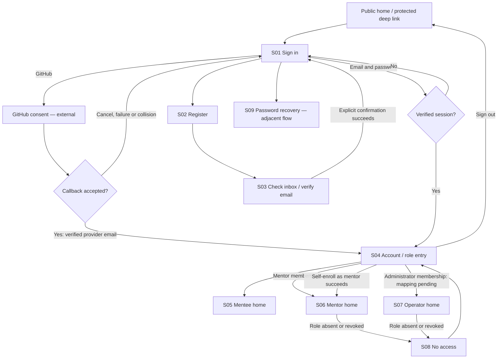

# Epic 01 — accounts and roles: screen map

Date: 2026-10-20. Status: planning artifact for review, not an implemented authentication flow. Scope: GitHub and email sign-in, registration, verification, three role home pages, and access denial. No application or design-system implementation is included.

## Sources and confidence

| ID | Source | How it is used |
| --- | --- | --- |
| TASK | Current user request: Epic 01, accounts and roles | Required flow and three role destinations; Epic 01 is supplied by the user, not reconstructed from a backlog |
| BRIEF | [Product brief](../.ai/specs/product-brief.md), D02–D04, N01–N02 | Product purpose and scope boundaries |
| AUTH | [Users/authentication specification](../.ai/specs/2026-10-16-users-auth-application-primitives.md) | Confirmed multi-role, verification, recovery and account-linking decisions; remaining route/security/UI design is a proposal |
| PEOPLE | [Personas](../.ai/specs/research/personas.md), [working developer](../.ai/specs/research/2026-08-20-interview-working-dev.md), [platform developer](../.ai/specs/research/2026-09-02-interview-platform-dev-solves-alone.md) | P01 urgent technical problem and P02 low-salience self-resolution; synthetic reactions are hypotheses, not observed behavior |
| DS | [Design-system progress](../packages/ui/POSTEP.md), [tokens](../packages/ui/src/tokens.css), [approved token decisions](../lekcja-06/tokeny.md), [approved home](../lekcja-06/ekran-bez-ds.html) | Visual language and available components; Stage 2 batch 1 only is complete |
| RULES | [Agent rules](../AGENTS.md) | Architecture, verification and access-control boundaries |

Missing supplied sources: `.ai/specs/backlog.md` and `.ai/specs/2026-09-04-accounts-and-roles.md`. AUTH is a newer supporting document, not a replacement silently assumed to have the same acceptance criteria. IDs S01–S09 and transitions below are local map identifiers, not backlog story IDs.

**Terminology:** this map uses *mentee* for AUTH's baseline *developer*. TASK's *operator* is provisionally mapped to AUTH's *administrator* for the proposed administrative destination. That equivalence needs confirmation; an operator bootstrap command does not itself define a separate application role. Users may hold multiple memberships. Role selection changes navigation context, never permissions.

## People and jobs

| Person | Job in this flow | Design consequence and evidence limit |
| --- | --- | --- |
| P01 — blocked developer | Access help for a concrete problem | Keep return navigation and next action clear; avoid unrelated setup. This is a design inference from PEOPLE, not validated authentication research |
| P02 — self-resolving developer | Assess help without unnecessary commitment | Keep public catalog/home accessible and explain why an account is needed at a protected action. Public access details still need feature-spec confirmation |
| Mentor | Reach their mentor workspace | Role intent comes from TASK/AUTH; no mentor persona is supplied in the persona file. Do not invent onboarding motivations |
| Operator | Reach authorized account administration | Role intent comes from TASK and proposed AUTH administration; no operator persona evidence is supplied |

## Flow

Proposed routing: after sign-in, return to a validated same-origin protected destination when authorized; otherwise open S04. Never follow arbitrary return URLs. An expired session leads to S01 with a neutral explanation; an authenticated user without permission receives S08. AUTH's GitHub callback uses fixed same-origin redirects: retaining a return destination would need an explicitly validated server-owned mechanism, not a new callback URL parameter.

## Screen inventory

Routes marked **proposed** are mapping suggestions. AUTH-listed routes are also unimplemented design, not current live application routes. The public home remains outside this map's build scope.

| ID / screen | Route / basis | Main content and action | Entry → exit | Access and data |
| --- | --- | --- | --- | --- |
| S01 Sign in | `/login` — AUTH | Email, password, **Sign in**, **Continue with GitHub**; registration, verification-resend and recovery links | Protected action, public navigation, verification completion → authorized return or S04 | Public; credentials stay out of URLs/logs. Generic invalid-credentials response, including unverified credentials |
| S02 Registration | `/register` — AUTH | Minimal specified identity fields: display name, email, password; **Create account**. Offer GitHub through the same provider flow, and link to sign-in | S01 → S03 after generic accepted response; GitHub success → S04 | Public; developer is baseline. No role picker granting mentor/admin; no silent identity merging |
| S03 Email verification | `/verify-email` — AUTH | Check-inbox instructions, resend form; token-present state with **Verify email**; confirmed state with **Sign in** | S02/email link/S01 resend → S01 on success; retry request on unusable token | Public token flow; verification does not imply an authenticated session. Keep email-response wording generic |
| S04 Account / role entry | `/account` — proposed route; account behavior AUTH | Current account, all current roles, available home links, **Become a mentor** for eligible verified developer, **Sign out** | Successful sign-in/no-access recovery → S05/S06/S07 or public home | Verified session; fetch current memberships, not role claims from client storage. Multiple roles stay available |
| S05 Mentee home | `/account/mentee` — proposed, TASK | Clear next step **Find a mentor**; link to account/role context. Reservation summary only when its separate feature and data contract exist | S04 / authorized deep link → public catalog or future own-bookings flow | Baseline developer. No invented reservations, counts, payments or feedback eligibility; BRIEF D02–D04 |
| S06 Mentor home | `/account/mentor` — proposed, TASK | Identify mentor context; future navigation to own profile/calendar and reservation approvals, explicitly outside Epic 01 implementation | S04 / successful mentor enrollment → own workspace when available | Mentor membership; never show another mentor's private data. Membership is not a promise of published profile or immediate availability |
| S07 Operator home | `/admin` → `/admin/users` — AUTH proposal, terminology pending | Account administration entry with users list and role-edit controls; not a commercial analytics dashboard | S04 / direct authorized entry → users and role update | Administrator only; baseline developer retained, no self-service admin grants, last administrator protected. Bootstrap stays a command, not a public screen |
| S08 No access | Inline forbidden page at protected route — proposed presentation, AUTH behavior | **You don't have access to this page**; explain required access without private data; **Go to my account**, optional **Sign out** | Authenticated missing/revoked role → S04 or S01 after sign-out | HTTP 403 for signed-in denial; unauthenticated browser redirects to S01. API 401/403 remains JSON. Do not replace every 404 with denial |
| S09 Password recovery | `/forgot-password`, `/reset-password` — AUTH, adjacent scope | Request email; set new password using valid token; return to **Sign in** after success | S01 → request confirmation → email link → reset → S01 | Documented navigation dependency, not an additional Epic 01 commitment without backlog confirmation. No automatic sign-in or credentials added to GitHub-only identities |

GitHub consent belongs to GitHub, not a locally designed screen. `/api/auth/github/start` and `/api/auth/github/callback` are system transitions; render pending/error feedback through S01 rather than inventing a separate product destination. Existing accounts with email/provider collisions are not linked; offer retry or original-method sign-in without exposing account details.

## State coverage and recovery

| Screen | Required states | Recovery / focus behavior |
| --- | --- | --- |
| S01 | Default; invalid/missing fields; submitting; generic credentials failure; GitHub redirect pending/cancel/provider failure/collision; rate limited; service unavailable; session expired | Preserve non-secret fields; focus first invalid field for field validation, announce form-level server errors. Retain button label while busy; prevent duplicate submission; retry or choose original method |
| S02 | Default; field validation; submitting; generic accepted response, including duplicate address/delivery failure; rate limit; unavailable | Accepted response gives inbox/resend/sign-in options without claiming delivery or exposing registration status. Do not persist password across navigation |
| S03 | Check inbox; resend pending/accepted/cooldown; token present awaiting confirmation; confirming; verified; invalid/expired/used token; unavailable | Do not consume token on page GET. Explicit protected POST confirms; unusable link offers new request. AUTH proposes 24-hour validity and replacement invalidating older tokens |
| S04 | Loading session/roles; loaded with one/multiple roles; mentor enrollment pending/success/failure; session expired; logout pending/failure | No role list until resolved; enrollment success updates memberships from server. Keep existing context on failure; session expiry returns to sign-in |
| S05 | Loading; authenticated baseline with no downstream feature data; future populated/empty/error summaries | A new account has a useful catalog next step. Empty state must not imply booking features already exist; retry only if a real request failed |
| S06 | Loading; authorized mentor; enrollment just completed; downstream profile not configured; error; role revoked | Distinguish membership from profile/calendar readiness. Recovery returns to account if access is lost; do not invent publication or approval status |
| S07 | Loading; populated users; no results / empty; request error; role update pending/success/failure; last-admin rejection; access revoked | Retry list request; preserve query; announce saved/failed update only after server response; refetch permissions after role change. Server rejects forbidden or last-admin removal |
| S08 | Authenticated forbidden; stale/revoked role; session expiry during navigation | Focus page heading on navigation; safe account link. Do not repeatedly redirect a signed-in denied user to login |
| S09 | Request default/pending/generic accepted; invalid/expired/used reset token; reset pending/success/error; rate limited/unavailable | Request new link; AUTH proposes 30-minute reset validity. Reset revokes sessions; success leads to login |

Shared states: field errors include words and an icon rather than color alone; server feedback is announced; required/optional labels are visible; disabled actions explain why. Honor server Retry-After for rate-limit recovery. Never show a success message until the server confirms the relevant operation; generic email acceptance confirms request handling, not delivery.

## Design-system mapping

| Need / screens | Reuse now | Gap / responsibility |
| --- | --- | --- |
| Primary submit, GitHub start, verification/enrollment/logout | [Button](../packages/ui/src/components/ui/button.tsx) | Owner supplies busy, disabled reason and server behavior; GitHub is an external auth action, not an invented Button variant |
| Navigation and text actions | [Link](../packages/ui/src/components/ui/link.tsx); text Button for mutations | Use anchors for destinations, buttons for actions; return URLs require application validation beyond a generic Link |
| Email/password/name fields | [Input](../packages/ui/src/components/ui/input.tsx), [Label](../packages/ui/src/components/ui/label.tsx), [FormField](../packages/ui/src/backend/fields/FormField.tsx) | App owns schemas, autocomplete, field errors and first-error focus. Textarea is available but not needed in this flow |
| Session/list feedback | [LoadingMessage](../packages/ui/src/backend/feedback/LoadingMessage.tsx), [ErrorMessage](../packages/ui/src/backend/feedback/ErrorMessage.tsx), [EmptyState](../packages/ui/src/backend/feedback/EmptyState.tsx) | Basic helpers exist; access-denied, verification and OAuth states require feature composition, not assumed finished patterns |
| Operator users list | [DataTable](../packages/ui/src/backend/tables/DataTable.tsx) | Domain DTO, query/pagination, role controls and permission rules are not implemented; do not force authentication into generic CrudForm Save/Cancel UX |
| Page shell, typography and spacing | [PageShell](../packages/ui/src/page-shell.tsx), DS tokens/styles | Auth layout and role navigation remain to be composed. No new palette, component variants or dependencies are approved by this map |

Use approved semantic tokens for surfaces, text, actions, focus, relationship spacing and control sizes in both themes. Keep one primary task per screen, visible keyboard focus, and layouts usable at 320, 768 and 1440px. Use password-manager autocomplete (`email`, `current-password`, `new-password`) as appropriate. Do not introduce a new red error palette, toast dependency or decorative card system. The existing primitive verification does not establish that any account screen is implemented or accessible.

## Boundaries and decisions to resolve

1. Restore/confirm the missing Epic 01 backlog and accounts specification before committing acceptance criteria; reconcile any conflicts with AUTH's proposed design.
2. Confirm terminology: mentee = developer, and whether operator = administrator or a different responsibility. Until then, S07 permissions are provisional and must not create an extra role.
3. Approve the account/role-home routes and post-login destination policy, including multi-role navigation. TASK requires the three homes; their detailed content and route names are proposals.
4. Confirm the boundary of password recovery and operator users/role editing within this epic. They are AUTH dependencies/scope, not inferred backlog stories.
5. Obtain mentor/operator task evidence and the actual external support contact before launch. Support remains an external contact; no on-site ticket/dispute/refund flow. No video, on-site payment/session chat, public ratings, subscriptions or vault features are added.

Current implementation boundary: this document describes future screens. In the current application `/admin` intentionally remains 404 until the authorized feature is implemented and its tests are replaced. This task does not advance Storybook Stage 2 batch 2 or Stage 3.

## Review checklist

- Walk email registration → generic acceptance → explicit verification → login → role entry.
- Walk GitHub new/returning user success; cancellation, missing verified email, collision and provider outage; no linking shortcut.
- Walk each role and a multi-role account; self-enroll mentor; never self-enroll administrator.
- Walk anonymous protected entry, expired session, signed-in wrong role and revoked access; distinguish redirect, 403 and 404.
- Review every tabled state in both themes, narrow layout and keyboard order; verify error announcements and retained non-secret input.
- Keep token-link pages free of third-party resources; strip raw fragment tokens from history per AUTH; do not expose tokens or credentials in analytics/logs.

These are future acceptance/verification scenarios, not checks executed against implemented account screens.
